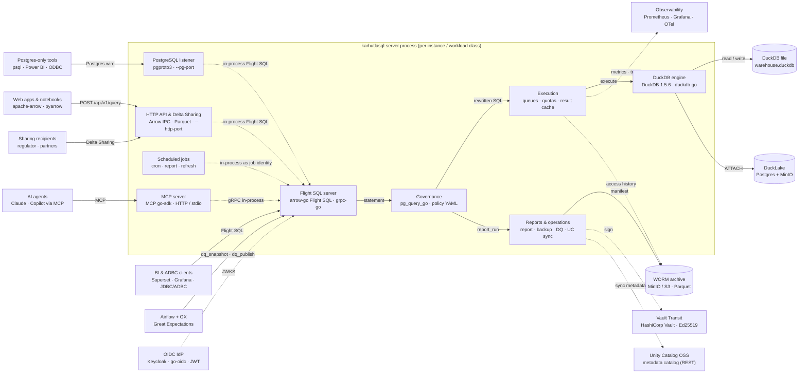

# KarhutlaSQL

A lightweight analytical SQL server: **Apache Arrow Flight SQL** on top of **DuckDB**, written in Go, shipped as a single static binary. Built for on-prem and air-gapped environments with audit requirements: SSO/OIDC, per-catalog authorization, session control, Prometheus metrics, and audit logs.

> Status: pre-1.0, under active development. See [plan.md](plan.md) for completed phases.
>
> 📖 Documentation & tutorials: https://sivi-shahab.github.io/KarhutlaSQL/ · 🗺️ [Interactive architecture diagram](https://sivi-shahab.github.io/KarhutlaSQL/diagram/architecture.html)

## Features

| Area | Features |
|---|---|
| Protocols | Arrow Flight SQL (JDBC, ADBC, Ibis, Superset, Grafana); PostgreSQL wire protocol for psql, Power BI/Npgsql, ODBC (`--pg-port`); HTTP Arrow IPC endpoint for web apps and notebooks (`--http-port`) — all through the same governance |
| Data sharing | Delta Sharing server for read-only sharing with regulators and partners (pandas, Spark, Power BI clients), governed and audited per recipient (`--sharing-file`) |
| Engine | DuckDB (file / in-memory), init SQL for extensions & ATTACH; multi-writer DuckLake (Postgres + MinIO) with one instance per workload class |
| Auth | Password → JWT, SSO/OIDC via JWKS, email/domain/group allow-list, TLS & mTLS |
| Authz | Default-deny object privileges (catalog/schema/table/column), YAML policy, hot reload, four-eyes approval |
| Governance | SQL rewriter: tag-based column masking, row-level security, `ai_sandbox` profile (SELECT-only + LIMIT); PII auto-classification suggests tags for untagged columns (`karhutla_classify_scan()`) |
| Compliance | Per-column PII access history → WORM Parquet (10-year retention, DSAR export), residency guardrail, signed report runs for regulatory reporting (OJK/SLIK) with DuckLake snapshot time travel |
| Workload control | Session registry, kill session, resource groups & statement queuing, rate limits, query timeouts, admin via Flight DoAction |
| Observability | Prometheus `/metrics` + `karhutla_metrics()`, `karhutla_query_history()`, slow-query log, JSON audit log |
| AI agents | MCP server (stdio + Streamable HTTP/OAuth) with the `ai_sandbox` profile enforced, verified queries + semantic model |
| Vector search | Similarity search on `FLOAT[n]` embeddings with DuckDB array functions, HNSW index via the `vss` extension (preview) — under the same row filters, masking, and audit |
| Web UI | Browser SQL editor, readable tables, sessions (kill), query history, and jobs at `/` on `--http-port`, embedded in the binary; same governance as the API |
| Operations | Bulk ingest (`adbc_ingest`), tiered backups to the WORM archive, versioned schema migrations, signing keys in Vault/HSM; scheduled jobs (cron) for signed reports and atomic materialized-table refreshes (`--jobs-file`) |

## Architecture



**[▶ Open the interactive diagram](https://sivi-shahab.github.io/KarhutlaSQL/diagram/architecture.html)**
(click a component for details, the **SRC** badge opens its source code, trace paths, export PNG/SVG; the full list of open-source tools is in the cards below the diagram) — also on the
[Architecture diagram](https://sivi-shahab.github.io/KarhutlaSQL/architecture) page of the docs site.
Diagram source: [`docs/public/diagram/architecture.json`](docs/public/diagram/architecture.json).

## Quick start

```bash
# build
make build

# run with the TPC-H sample + self-signed TLS
make testdata
KARHUTLASQL_PASSWORD=secret ./bin/karhutlasql-server --username admin \
  --database-filename tests/data/tpch_sf0_01.duckdb \
  --tls-self-signed --print-queries

# CLI client
KARHUTLASQL_PASSWORD=secret ./bin/karhutlasql-client \
  --host localhost --port 31337 --username admin --tls --tls-skip-verify \
  --command "SELECT count(*) FROM lineitem"
```

Python (ADBC):

```python
from adbc_driver_flightsql import dbapi, DatabaseOptions
conn = dbapi.connect(
    "grpc+tls://localhost:31337",
    db_kwargs={
        DatabaseOptions.AUTHORIZATION_HEADER.value: "Basic YWRtaW46c2VjcmV0",
        DatabaseOptions.TLS_SKIP_VERIFY.value: "true",
    },
)
```

JDBC (DBeaver, Arrow Flight SQL driver):

```
jdbc:arrow-flight-sql://localhost:31337?useEncryption=true&user=admin&password=secret&disableCertificateVerification=true
```

Step-by-step guides: [quick start](https://sivi-shahab.github.io/KarhutlaSQL/guide/quick-start) and [tutorials](https://sivi-shahab.github.io/KarhutlaSQL/tutorials/01-first-query).

## Docker

```bash
make docker   # karhutlasql:dev, distroless/static, server + client
docker run --rm -p 31337:31337 -p 9090:9090 -e KARHUTLASQL_PASSWORD \
  -v karhutlasql-data:/data karhutlasql:dev
./bin/karhutlasql-client --host localhost --tls-skip-verify
```

Image defaults: `--database-filename /data/warehouse.duckdb --username admin --tls-self-signed` (in-memory certificate; use `--tls-cert/--tls-key` in production). The static image cannot `LOAD` DuckDB extensions (ADR 19); for DuckLake use `make docker-lake` ([docs/ducklake.md](docs/ducklake.md)). Compose: `deploy/compose/compose.yaml`.

Kubernetes: see `deploy/helm/` and [docs/deploy-k8s.md](docs/deploy-k8s.md).

## Benchmark (TPC-H SF10)

`tests/bench/tpch_bench.py`, 5 interleaved rounds, median per query; an
end-to-end Python ADBC client vs the DuckDB 1.5.6 CLI (`.mode trash`) on the
same file. Dev machine: 16 vCPU, 15 GB RAM, WSL2 (CPU shared with the host —
absolute numbers vary between sessions, ratios within a session are stable).

| | Total, 22 queries | Overhead vs CLI |
|---|---|---|
| DuckDB CLI | 10.51 s | — |
| karhutlasql-server (default: streaming, profiling off) | 10.86 s | **+3.3%** |
| karhutlasql-server `--streaming-buffer-size=0` (materialized) | 11.36 s | +8.1% |
| `--query-profiling` (separate session) | — | +~13 percentage points |

Large result (7.6 million `lineitem` rows): CLI 1.7 s. Server with streaming:
first batch 0.5–0.7 s, total 9.6–11 s; materialized: first batch 2.2–4.5 s,
total 6.2–8.7 s, with unbounded result memory. Huge exports take ~25% longer
with streaming; a larger buffer (`--streaming-buffer-size`) moves it closer to
materialized. Arrow batches to the client: 64k rows. Details: ADR 33–34.

## Documentation

- Docs site: https://sivi-shahab.github.io/KarhutlaSQL/ — why KarhutlaSQL, quick start, concepts, 10 tutorials, reference
- Source pages: [docs/install.md](docs/install.md) · [docs/config.md](docs/config.md) · [docs/auth.md](docs/auth.md) · [docs/policy.md](docs/policy.md) · [docs/monitoring.md](docs/monitoring.md) · [docs/client.md](docs/client.md)
- Design (in Indonesian): [spec.md](spec.md) · [arsitektur.md](arsitektur.md) · [plan.md](plan.md) · [ADRs](arsitektur.md) (§10)
- Research on features & compliance: [docs/research/fitur-lanjutan.md](docs/research/fitur-lanjutan.md)

## Development

```bash
make lint test             # unit tests
make test-integration      # needs docker + a python venv
make run-dev
make docs                  # docs site (VitePress, needs Node 22) → docs/.vitepress/dist
```

See [CONTRIBUTING.md](CONTRIBUTING.md). Security reports: [SECURITY.md](SECURITY.md).

## License

Apache License 2.0 — see [LICENSE](LICENSE) and [NOTICE](NOTICE). Third-party dependencies: [THIRD_PARTY.md](THIRD_PARTY.md).
