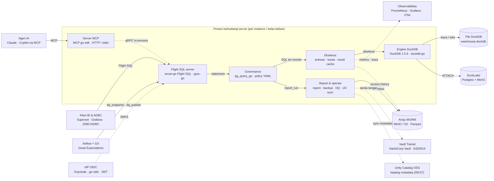

# KarhutlaSQL

Server SQL analitik ringan: **Apache Arrow Flight SQL** di atas **DuckDB**, ditulis dalam Go, satu binary statis. Dirancang untuk lingkungan on-prem/air-gapped dengan kebutuhan audit: SSO/OIDC, otorisasi per-catalog, session control, Prometheus metrics, audit log.

> Status: pra-1.0, dalam pengembangan. Lihat [plan.md](plan.md) untuk fase yang sudah selesai.
>
> 📖 Dokumentasi: https://sivi-shahab.github.io/KarhutlaSQL/ · 🗺️ [Diagram arsitektur interaktif](https://sivi-shahab.github.io/KarhutlaSQL/diagram/arsitektur.html)

## Fitur

| Area | Fitur |
|---|---|
| Protokol | Arrow Flight SQL (JDBC, ADBC, Ibis, Superset, Grafana kompatibel) |
| Engine | DuckDB (file / in-memory), init SQL untuk extension & ATTACH; DuckLake multi-writer (Postgres + MinIO) dengan instance per kelas beban |
| Auth | Password → JWT, SSO/OIDC via JWKS, allowlist email/domain/group, TLS & mTLS |
| Authz | Object privileges default-deny (catalog/schema/table/column), policy YAML, hot reload, four-eyes approval |
| Governance | SQL rewriter: column masking berbasis tag klasifikasi, row-level security, profil `ai_sandbox` (SELECT-only + LIMIT) |
| Kepatuhan | Access-history per kolom PII → Parquet WORM (retensi 10 th, DSAR export), residency guardrail, report run bertanda tangan untuk laporan OJK/SLIK (time travel snapshot DuckLake) |
| Operasional | Session registry, kill session, resource group & statement queuing, rate limit, query timeout, admin via Flight DoAction |
| Observabilitas | Prometheus `/metrics` + `karhutla_metrics()`, `karhutla_query_history()`, slow-query log, audit log JSON |
| Agen AI | Server MCP (stdio + Streamable HTTP/OAuth) dengan profil `ai_sandbox` dipaksakan, verified queries + semantic model |
| Operasi | Bulk ingest (`adbc_ingest`), backup bertingkat ke arsip WORM, schema migration berversi, kunci tanda tangan di Vault/HSM |

## Arsitektur



**[▶ Buka diagram interaktif](https://sivi-shahab.github.io/KarhutlaSQL/diagram/arsitektur.html)**
(klik komponen, badge **SRC** membuka kode sumbernya, telusuri jalur, ekspor PNG/SVG; daftar lengkap tool open source ada di kartu bawah diagram) — juga di halaman
[Diagram arsitektur](https://sivi-shahab.github.io/KarhutlaSQL/architecture/) situs
dokumentasi. Sumber diagram: [`docs/diagram/arsitektur.architecture.json`](docs/diagram/arsitektur.architecture.json).

## Quick start

```bash
# build
make build

# jalankan dengan sample TPC-H + TLS self-signed
make testdata
KARHUTLASQL_PASSWORD=secret ./bin/karhutlasql-server --username admin \
  --database-filename tests/data/tpch_sf0_01.duckdb \
  --tls-self-signed --print-queries

# klien CLI
KARHUTLASQL_PASSWORD=secret ./bin/karhutlasql-client \
  --host localhost --port 31337 --username admin --tls --tls-skip-verify \
  --command "SELECT count(*) FROM lineitem"
```

Python (ADBC):

```python
from adbc_driver_flightsql import dbapi, DatabaseOptions
conn = dbapi.connect(
    "grpc+tls://localhost:31337",
    db_kwargs={
        DatabaseOptions.AUTHORIZATION_HEADER.value: "Basic YWRtaW46c2VjcmV0",
        DatabaseOptions.TLS_SKIP_VERIFY.value: "true",
    },
)
```

JDBC (DBeaver, driver Arrow Flight SQL):

```
jdbc:arrow-flight-sql://localhost:31337?useEncryption=true&user=admin&password=secret&disableCertificateVerification=true
```

## Docker

```bash
make docker   # karhutlasql:dev, distroless/static, server + client
docker run --rm -p 31337:31337 -p 9090:9090 -e KARHUTLASQL_PASSWORD \
  -v karhutlasql-data:/data karhutlasql:dev
./bin/karhutlasql-client --host localhost --tls-skip-verify
```

Default image: `--database-filename /data/warehouse.duckdb --username admin --tls-self-signed` (sertifikat di memori; produksi pakai `--tls-cert/--tls-key`). Image statis tidak bisa `LOAD` ekstensi DuckDB (ADR 19); untuk DuckLake pakai `make docker-lake` ([docs/ducklake.md](docs/ducklake.md)). Compose: `deploy/compose/compose.yaml`.

Kubernetes: lihat `deploy/helm/` dan [docs/deploy-k8s.md](docs/deploy-k8s.md).

## Benchmark (TPC-H SF10)

`tests/bench/tpch_bench.py`, 5 ronde bergantian, median per query; klien ADBC
Python end-to-end vs DuckDB CLI 1.5.6 (`.mode trash`) pada file yang sama.
Mesin dev: 16 vCPU, 15 GB RAM, WSL2 (CPU berbagi dengan host — angka absolut
berfluktuasi antar sesi, rasio dalam satu sesi stabil).

| | Total 22 query | Overhead vs CLI |
|---|---|---|
| DuckDB CLI | 10,51 s | — |
| karhutlasql-server (default: streaming, profiling mati) | 10,86 s | **+3,3%** |
| karhutlasql-server `--streaming-buffer-size=0` (materialisasi) | 11,36 s | +8,1% |
| `--query-profiling` (sesi terpisah) | — | +~13 poin persen |

Hasil besar (7,6 juta baris `lineitem`): CLI 1,7 s. Server streaming: batch
pertama 0,5–0,7 s, total 9,6–11 s; materialisasi: batch pertama 2,2–4,5 s,
total 6,2–8,7 s dan memori hasil tidak terbatas. Ekspor raksasa ~25% lebih
lama dengan streaming; buffer lebih besar (`--streaming-buffer-size`)
mendekatkan ke materialisasi. Batch Arrow ke klien: 64k baris. Detail: ADR
33–34.

## Dokumentasi

- [docs/install.md](docs/install.md) · [docs/config.md](docs/config.md) · [docs/auth.md](docs/auth.md) · [docs/policy.md](docs/policy.md) · [docs/monitoring.md](docs/monitoring.md) · [docs/client.md](docs/client.md)
- Desain: [spec.md](spec.md) · [arsitektur.md](arsitektur.md) · [plan.md](plan.md) · [ADR](arsitektur.md) (§10)
- Riset fitur & kepatuhan: [docs/research/fitur-lanjutan.md](docs/research/fitur-lanjutan.md)

## Pengembangan

```bash
make lint test             # unit
make test-integration      # butuh docker + python venv
make run-dev
```

Lihat [CONTRIBUTING.md](CONTRIBUTING.md). Laporan keamanan: [SECURITY.md](SECURITY.md).

## Lisensi

Apache License 2.0 — lihat [LICENSE](LICENSE) dan [NOTICE](NOTICE). Dependency pihak ketiga: [THIRD_PARTY.md](THIRD_PARTY.md).
